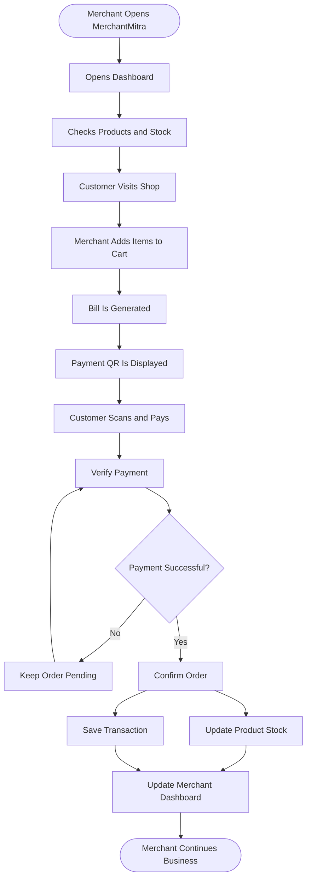
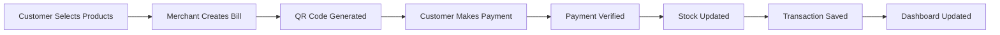
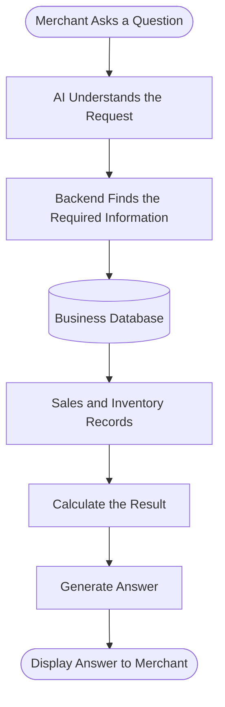
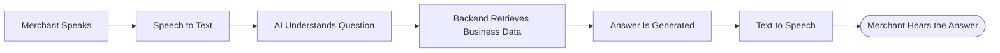

# MerchantMitra

### Beyond Payments. Towards Intelligent Business Growth.

MerchantMitra is a merchant management platform designed to make everyday business operations easier for small and medium-sized shop owners.

A shop owner manages products, prepares bills, accepts payments, tracks stock and tries to understand how the business is performing. MerchantMitra brings these activities together in one place.

The idea is simple: **help merchants not only collect money, but also understand and manage their business.**

---

## The Problem

Many small shop owners still manage different parts of their business separately.

- Billing and payment records are maintained using different tools.
- Merchants may know their daily collections but not their actual gross profit.
- Tracking available stock and knowing when to reorder products can be difficult.
- It is not always easy to identify the best-selling and slow-moving products.
- Merchants often lack clear information about their daily and monthly business performance.
- Some merchants find complicated digital platforms difficult to use, especially when they prefer their local language.

They need something more than a payment application. They need a simple platform that helps them run their business.

## What We Are Building

MerchantMitra brings everyday shop operations into one platform.

**Product Management**

Merchants can add products, set prices, record purchase costs and maintain available stock quantities.

**Smart Billing**

When a customer purchases something, the merchant adds the products to a cart and generates a bill.

**Digital Payments**

The platform can generate an order-specific UPI QR through an eligible payment provider integration. Customers scan it using their UPI application and complete the payment.

**Automatic Inventory Updates**

Once the payment is successfully verified, the purchased quantities are deducted from the available stock.

**Business Analytics**

Merchants can view sales, gross profit, best-selling products, slow-moving products and stock information.

**AI Business Assistant**

Instead of manually checking reports, merchants can ask questions about their business and receive answers based on their actual records.

**Voice Assistance**

Merchants can interact with the assistant using supported Indian languages.

**Customer Engagement**

The platform can support loyalty rewards, coupons and repeat-customer engagement with appropriate customer consent.

---

## How MerchantMitra Works

Imagine a customer entering a grocery shop.

The merchant opens MerchantMitra, selects the products purchased by the customer and generates a bill. The customer pays by scanning the displayed QR code. After payment verification, MerchantMitra records the sale and updates the stock.

The merchant can then see the updated business information on the dashboard.

## A Customer Purchase — Example Simulation

Consider a customer purchasing two products from a grocery shop.

| Product | Quantity | Amount |
|---|---:|---:|
| Rice (1 kg) | 2 | ₹120 |
| Cooking Oil | 1 | ₹150 |
| **Total** | | **₹270** |

This is how the purchase moves through MerchantMitra:

For example, if the shop initially has 50 packets of rice and 30 bottles of oil, after this verified purchase the available quantities become 48 packets and 29 bottles.

This is an illustrative simulation, not a live payment transaction.

## AI Business Assistant

A merchant should not have to search through multiple reports to understand how the shop is performing.

With MerchantMitra, the merchant can simply ask a question.

**Example:**

Merchant: "Which product sold the most today?"

MerchantMitra: "Rice (1 kg) was your best-selling product today, with 32 units sold."

Example response using illustrative data.

Behind the scenes, the assistant identifies the question, retrieves the relevant business records and calculates the result before responding.

Some questions merchants can ask:

- How much did I sell today?
- What is my gross profit?
- Which product sells the most?
- Which products are running low?
- What should I restock?
- Which products are not selling well?
- What are my busiest business hours?

Gemini is intended to understand questions and coordinate responses. Actual sales, stock and profit figures must come from backend calculations using recorded business data.

## Multilingual Voice Assistance

Not every merchant is comfortable typing questions into an application. MerchantMitra aims to make interaction easier through voice.

For example, a merchant can ask:

**"ಇವತ್ತು ಎಷ್ಟು ಲಾಭ ಬಂದಿದೆ?"**

The platform converts the speech into text, understands the question, retrieves the required business information and speaks the response.

The proposed voice technologies are:

- **Sarvam Saaras:** Speech-to-text.
- **Gemini API:** Understanding business questions.
- **Sarvam Bulbul:** Text-to-speech.

Language support depends on the capabilities of the selected speech services.

## Inventory and Customer Management

MerchantMitra also helps merchants keep track of products and maintain customer relationships.

**Inventory management**
- Check available product quantities.
- Set minimum stock levels.
- Identify products that need restocking.
- Understand which products sell quickly or slowly.
- Update stock after successful payment verification.

**Customer engagement**
- Offer purchase-based loyalty rewards.
- Suggest coupons for eligible purchases.
- Identify repeat customers using voluntarily provided or verified details.
- Support promotional communication with appropriate customer consent.

---

## System Architecture

The following diagram shows how the different parts of MerchantMitra work together.

## Technology Stack

| Component | Technology |
|---|---|
| Frontend | React.js |
| Styling | Tailwind CSS |
| Backend | Node.js, Express.js |
| Database | MongoDB Atlas |
| Payment Integration | Paytm Dynamic QR API / eligible payment provider |
| AI Assistant | Google Gemini API |
| Speech Recognition | Sarvam Saaras |
| Speech Generation | Sarvam Bulbul |
| Charts | Recharts |
| Real-time Communication | Socket.IO |
| Version Control | Git and GitHub |
| Deployment | Vercel and Render |

*This table describes the proposed technology stack. Integrations will be considered implemented only after they have been connected and tested.*

## Our Goal

We are building MerchantMitra to make everyday business management easier for small shop owners.

A merchant should be able to understand how much the shop sells, which products perform well, what needs restocking and where the business can improve — without having to manage everything separately.

We want to make useful business information accessible through a platform that is simple to use.

**MerchantMitra — Beyond Payments. Towards Intelligent Business Growth.**
